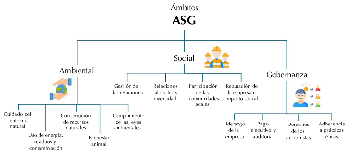

# UT1-A4 - Inversión socialmente responsable en el ámbito tecnológico

## 1. Resultado de aprendizaje, contenido y criterios de evaluación

### Resultado de aprendizaje
RA1. Identifica los aspectos ambientales, sociales y de gobernanza (ASG) relativos a la sostenibilidad teniendo en cuenta el concepto de desarrollo sostenible y los marcos internacionales que contribuyen a su consecución.

### Contenido
Inversión socialmente responsable (ISR). 
Analistas, índices y agencias de sostenibilidad.

### Criterios de evaluación
e) Se han identificado los principales estándares de métricas para la evaluación del desempeño en sostenibilidad y su papel en la rendición de cuentas que marca la legislación vigente y las futuras regulaciones en desarrollo. 
f) Se ha descrito la inversión socialmente responsable y el papel de los analistas, inversores, agencias e índices de sostenibilidad en el fomento de la sostenibilidad.

##  2. Agrupamiento

Individual

##  3. Contexto

La inversión socialmente responsable (ISR) ha hecho que los criterios ambientales, sociales y de gobernanza pesen cada vez más en las decisiones de los inversores. Trabajas en el departamento de análisis de una entidad que quiere conocer cómo entran las empresas tecnológicas en los índices de sostenibilidad y qué iniciativas de inversión responsable impulsan.

##  4. Objetivo de la actividad

El alumno debe **investigar** un índice de sostenibilidad y una empresa tecnológica que forme parte de él, **explicar** los criterios ASG que se usan para seleccionarla, **analizar** una iniciativa concreta de inversión responsable y **reflexionar** sobre el papel de la informática en la sostenibilidad empresarial.

##  5. Enunciado de la actividad

Los criterios ASG son un conjunto de normas que se deben seguir para tomar decisiones empresariales pensando tanto en cuestiones financieras como en impacto medioambiental y social; y así tomar las decisiones más sostenibles y responsables.

En detalle, ASG significa:

- Ambiental: cómo la empresa afecta y cuida el medio ambiente.

- Social: cómo la empresa protege y relaciona con las personas (empleados, comunidad, clientes).

- Gobernanza: cómo se organiza y gobierna la empresa para ser transparente, ética y responsable**.**

  **Calificaciones de sostenibilidad**

  Las calificaciones (ratings) de sostenibilidad o ASG son valoraciones del desempeño en sostenibilidad de una entidad pública o privada hechas por una institución independiente.

  Son las fuentes más consultadas en los mercados financieros para tomar decisiones ISR y también para configurar índices de sostenibilidad.

  Los sistemas de calificación, como [MSCI](https://www.msci.com/data-and-analytics/sustainability-solutions/esg-ratings-climate-search-tool#watch_our_esg_video) y Sustainalytics, evalúan la actuación y gestión de las empresas y su impacto positivo en aspectos ASG. Con base en su calificación, las entidades pueden entrar en listados ordenados (clasificaciones o rankings) que atienden a determinados criterios ASG.

  Ver vídeo de Clasificación Sustainalytics : 

  Video: https://www.youtube.com/watch?v=bJgMM31wiRs&time_continue=5&source_ve_path=NzY3NTg&embeds_referring_euri=https%3A%2F%2Fwww3.gobiernodecanarias.org%2F

### **Índices de sostenibilidad**

Los índices de sostenibilidad son índices bursátiles que atienden los aspectos ASG de las empresas.

El objetivo de los índices de sostenibilidad es sintetizar en un único elemento (un dato, una clasificación, etc.) información muy diversa relacionada con la sostenibilidad empresarial.

La posición y la permanencia en estos índices dependen de que la empresa demuestre sus progresos constantes en cuestiones ASG.

De esta manera, se muestra públicamente qué empresas están implicadas efectivamente en la sostenibilidad, y en qué grado, y se facilita que los inversores encuentren proyectos y empresas ISR.

Existen decenas de índices, entre los que destacan el Índice Dow Jones de Sostenibilidad (DJSI, por las siglas en inglés), que se centra en un cierto número de empresas que cotizan en bolsa, el Índice FTSE4Good, que se elabora a partir de información pública de las empresas, y el Índice FTSE4Good IBEX, que analiza las empresas españolas del Ibex 35.

### **Ejercicio:**

1. **Búsqueda de un índice de sostenibilidad:**

- a\) Investiga un índice de sostenibilidad (por ejemplo, FTSE4 Good Europe Index, MSCI Europe ESG Leaders Index o IBEX ESG) y localiza al menos **una empresa del sector tecnológico o de servicios informáticos** que forme parte de ese índice.
- b\) Explica en qué consiste el índice elegido.
- c\) Indica qué criterios de sostenibilidad se usan para seleccionar a las empresas.
- d\) Señala la empresa escogida y su vinculación con la informática o las telecomunicaciones (ej.: Indra, Telefónica).

2. **Artículo sobre inversión responsable:**

**AUDIOVISUAL. Puedes consultar este podcast de la Comisión Nacional del Mercado de Valores sobre la Inversión Socialmente Responsable. **[**https://www.ivoox.com/inversion-sostenible-audios-mp3_rf_108966925_1.html**](https://www.ivoox.com/inversion-sostenible-audios-mp3_rf_108966925_1.html)

- **a) Busca y selecciona un artículo (puede ser de prensa digital, blog especializado o página oficial de la empresa) donde se explique alguna iniciativa concreta de inversión responsable o sostenible de esa compañía.**
- **b) Haz un breve resumen del artículo (5-7 líneas).**
- **c) Explica qué relación tiene la iniciativa con los criterios ASG (Ambientales, Sociales y de Gobernanza).**
- **d) Comenta cómo podría influir esta inversión en el ámbito de las tecnologías de la información (ej.: eficiencia energética en centros de datos, impulso de la economía digital sostenible, reducción de residuos tecnológicos, etc.).**

##  6. Material proporcionado al alumnado

- Texto introductorio sobre los criterios ASG y los índices de sostenibilidad (incluido en el enunciado).
- Podcast de la Comisión Nacional del Mercado de Valores sobre Inversión Socialmente Responsable (enlace en el enunciado).
- Acceso a internet para localizar el índice, la empresa y el artículo.

# 7. Entrega

- Documento estructurado con todos los apartados anteriores y, además:
- Introducción: qué es la inversión socialmente responsable.
- Índice seleccionado y empresa tecnológica vinculada.
- Resumen del artículo encontrado.
- Reflexión personal: ¿qué papel crees que debe jugar la informática en la sostenibilidad empresarial?
- Formato del documento: pdf.
- **Nombre del fichero: tuNombre_Apellido1_Apellido2_UT1-A4.pdf**

# 8. Rúbrica

| Criterio | Excelente | Bien | Suficiente | Insuficiente |
| :--- | :--- | :--- | :--- | :--- |
| **1. Descripción del Índice de Sostenibilidad y Empresa TIC (1.a, 1.b y 1.d) (CE f)** | Identifica de forma precisa un índice de sostenibilidad válido y una empresa tecnológica o de telecomunicaciones perteneciente a él. Explica detalladamente el índice y justifica claramente la vinculación de la empresa con el sector. (2,50 puntos) | Identifica el índice y la empresa tecnológica de forma correcta, pero la explicación del índice o la justificación de la vinculación TIC presenta imprecisiones menores. (1,88 puntos) | Identifica el índice y la empresa, pero la explicación es muy básica o superficial y apenas fundamenta la relación de la empresa con el sector tecnológico. (1,25 puntos) | No identifica un índice o empresa válidos, o la explicación es incorrecta, confusa o está ausente. (0,00 puntos) |
| **2. Criterios de Selección del Índice (1.c) (CE e)** | Describe con exactitud y vocabulario técnico preciso los criterios de sostenibilidad (ambientales, sociales y de gobernanza) utilizados para seleccionar a las empresas en el índice. (2,00 puntos) | Describe correctamente los criterios de sostenibilidad aplicados por el índice, aunque con alguna imprecisión menor o falta de detalle. (1,50 puntos) | Menciona los criterios de selección del índice de forma muy general, incompleta o esquemática. (1,00 puntos) | La descripción de los criterios de selección es incorrecta, totalmente confusa o se omite. (0,00 puntos) |
| **3. Búsqueda y Resumen de la Iniciativa ISR (2.a y 2.b) (CE f)** | Selecciona un artículo pertinente sobre una iniciativa concreta de inversión responsable y redacta un resumen sintético y claro ajustado a la extensión solicitada (5-7 líneas). (2,50 puntos) | Selecciona una fuente adecuada y resume la iniciativa de forma clara, aunque incumple levemente la extensión (muy breve o extensa) o presenta pequeñas deficiencias de síntesis. (1,88 puntos) | Selecciona una fuente vaga y el resumen es deficiente, impreciso o no respeta la extensión indicada. (1,25 puntos) | No aporta el artículo, el resumen no se corresponde con una iniciativa ISR o el apartado está ausente. (0,00 puntos) |
| **4. Vinculación ASG e Impacto en las TIC (2.c y 2.d) (CE e)** | Vincula de forma exhaustiva la iniciativa con los tres pilares ASG y aporta una reflexión crítica bien argumentada sobre su impacto en el ámbito de las TIC (eficiencia energética, e-waste, economía digital). (2,00 puntos) | Relaciona correctamente la iniciativa con los criterios ASG y comenta su impacto en el sector TIC, aunque con un nivel de análisis o profundización moderado. (1,50 puntos) | Identifica la relación ASG de forma superficial y realiza un comentario genérico o poco estructurado sobre su impacto en las tecnologías de la información. (1,25 puntos) | No explica la relación con los criterios ASG ni reflexiona sobre la influencia en el ámbito de las TIC, o el análisis es erróneo. (0,00 puntos) |
| **Formato del documento** | Incluye portada (título, curso y nombres de los integrantes), índice, contenido y bibliografía (o webgrafía). (1,00 puntos) | Faltan algún elemento de la portada, pero el contenido existe bien estructurado. Existe la bibliografía o webgrafía (0,75 puntos) | Faltan varios elementos, pero el contenido existe bien estructurado (0,25 puntos) | No entrega documento o solo un contenido mal formateado. (0,00 puntos) |

Penalización por entrega fuera de plazo

| Criterio | Se retrasa más de 5 días | Se retrasa entre 4 y 5 días | Se retrasa entre 2 y 3 días | Se retrasa 1 día | Entrega en plazo |
| :--- | :--- | :--- | :--- | :--- | :--- |
| **Entrega tarea en plazo** | -5 puntos | -3 puntos | -2 puntos | -1 punto | 0 puntos |